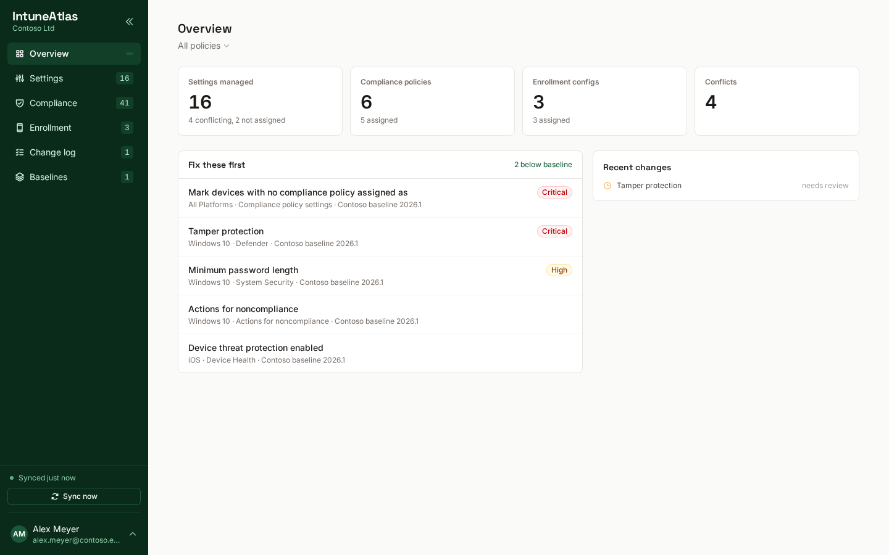
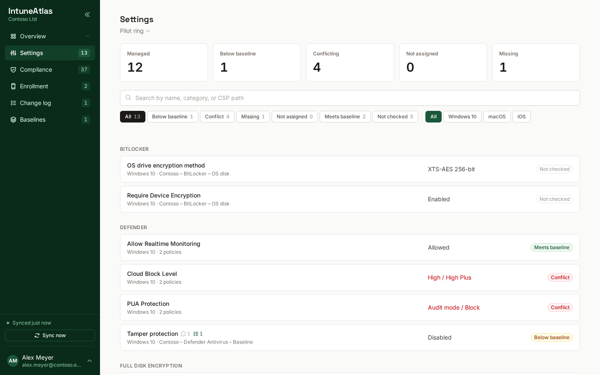
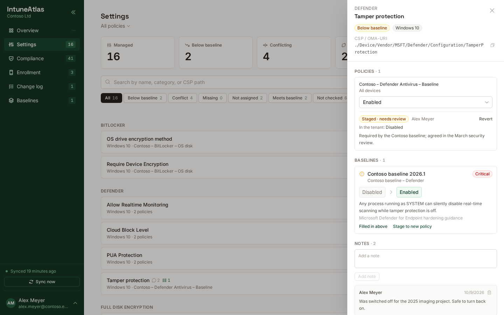
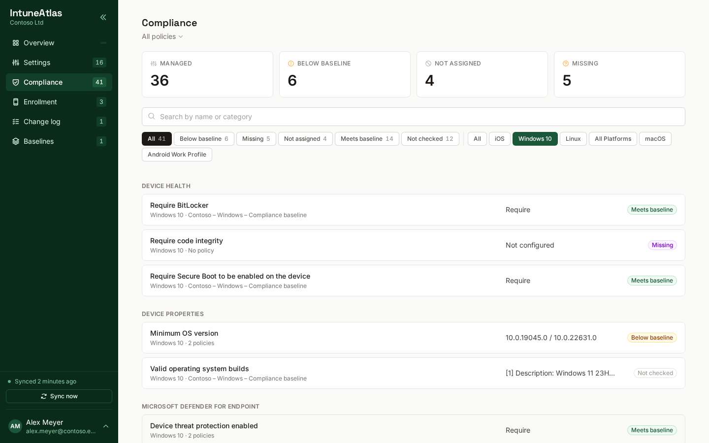

# IntuneAtlas

**[intuneatlas.com](https://intuneatlas.com)**

All of your Intune settings in one place, across every policy that sets
them.

The Intune portal is organised around policies, while devices apply the
combined settings of every policy that reaches them. IntuneAtlas reads your
tenant and lists each setting once, grouped by category, with every policy
that sets it and its value. Conflicts between policies, settings that reach
no devices, and differences from a baseline are shown alongside. It covers
configuration and compliance policies, for the whole tenant or for one group.

<p>
  
  
</p>
<p>
  
  
</p>

**Status: early.** Scanning, baselines, per-group views, reviewed changes and
pushing them to Intune all work today; the roadmap below lists what's still
missing. The core logic is covered by the tests in [`test/`](./test).

## Getting started

```
irm https://intuneatlas.com/install.ps1 | iex          # Windows
curl -fsSL https://intuneatlas.com/install.sh | bash    # Linux
```
```
intuneatlas ui --tenant <your-tenant>.onmicrosoft.com
```

That's all you need to run it on your own machine.

**For a team, host it on Azure.** One template deploys IntuneAtlas as a
Container App in your own subscription: its own HTTPS address, everyone
signing in with their own Microsoft account, roles for who may stage, review
and push. There's no server or certificate for you to maintain.

[](https://portal.azure.com/#create/Microsoft.Template/uri/https%3A%2F%2Fraw.githubusercontent.com%2Fjgeselle%2Fintuneatlas%2Fmain%2Finfra%2Fazure%2Fazuredeploy.json)

Steps, parameters and what it creates are in [`infra/azure`](./infra/azure).

The **[Getting started guide](https://intuneatlas.com/docs/)**
covers the one-time Entra app registration the first sign-in needs, sharing
it with a team and assigning roles, and has the full
[CLI reference](https://intuneatlas.com/docs/cli.html). Building from a
clone instead: `npm install && npm run build && node dist/cli.js ui`.

## What's in this repo

| Path | What it is |
|---|---|
| [`index.html`](./index.html) | Static marketing/landing page for the project |
| [`docs/`](./docs) | The getting started guide and CLI reference served at intuneatlas.com/docs |
| [`src/`](./src) | The CLI — auth, Graph scanning, settings index, local server |
| [`web/`](./web) | The local web UI (Vite + React), served by `intuneatlas ui` |
| [`test/`](./test) | Fixture-driven regression tests for the merge/conflict/baseline logic and the auth/authorization layer |
| [`Dockerfile`](./Dockerfile), [`infra/azure/`](./infra/azure) | The app as a container image, and a template that deploys it to Azure Container Apps |
| [`baselines/`](./baselines) | How a baseline folder is laid out — no baselines ship with the app |
| [`scripts/seed-tenant/`](./scripts/seed-tenant) | Dev-only tooling that seeds a dedicated test tenant — see [`TESTING.md`](./TESTING.md) |
| [`_headers`](./_headers) | Cloudflare Pages response headers (CSP, etc.) for the landing page |

## The idea

Every setting is in exactly one of six states:

- **Conflict** — two policies set the same setting to different values and
  can reach the same group. Different values for different groups, such as
  update rings, are not a conflict.
- **Below baseline** — the setting falls short of a baseline you've loaded:
  the Open Intune Baseline, a CIS export, or your own gold-standard policies.
- **Missing** — a baseline expects a setting that no policy configures.
- **Not assigned** — a policy sets it, but the policy isn't assigned to any
  group, so it doesn't reach any devices.
- **Meets baseline** / **Not checked** — passing, or not covered by any
  active baseline. These two are kept in the background.

Around that:

- **One group at a time.** Pick a group and every page shows only what
  reaches it — assigned to it, to a group containing it, or to everyone —
  with conflicts and baseline results worked out again for that group.
- **Custom OMA-URI rows too.** Every row of a custom Windows profile is a
  setting of its own, keyed by its OMA-URI, so it shows up in search, history
  and reminders like any other. Intune encrypts their text and certificate
  values, so those show by file name or as encrypted, and can't be edited here.
- **Compliance policies as settings.** What compliance policies demand is
  listed the same way, for Windows, iOS, macOS, Android and Linux, including
  the actions for noncompliance and the tenant-wide compliance settings.
- **Values as Intune has them.** A value shows, and can be edited, with the
  same options, ranges, lists and sub-settings the portal offers.
- **Staged, reviewed, then pushed.** A changed value is staged in the policy
  that holds it or in a new policy you name, and needs a reason and a
  reviewer — an Admin, who may be the one who staged it. An Admin can then
  push it to Intune — one change at a time, after a check that the tenant
  still holds the value the change was staged from. Pushing needs a write
  permission the app doesn't have unless you add it.
- **A history per setting.** Every scan is compared with the one before, and
  what changed — a value, a policy starting or no longer setting it, an
  assignment — is kept on the setting, whoever made the change and wherever.
- **From the terminal too.** `intuneatlas search` finds settings in the last
  scan; `intuneatlas check --group <group> --baseline <folder-or-url>` holds
  it against a baseline — a folder of the Open Intune Baseline on GitHub, say
  — and exits non-zero when something needs attention.
- **Notes.** A note can be attached to any setting, for example to explain a
  deliberate difference from a baseline, so the reason stays with it.
- **Reminders.** Any setting can carry a reminder — once, or every few
  months — such as renewing a trusted publisher's code-signing certificate.
  They're shared by everyone on the instance, and a bell shows what's due.
- **Light or dark.** The app follows the system's appearance, or the choice
  made in the account menu.

## Baselines

A baseline is a folder of **policies exported from Intune** — Settings
Catalog policies and compliance policies, the JSON exactly as exported,
nothing converted. Settings are matched to your tenant by Intune's own
setting ID, and compared value by value, sub-settings included. A baseline is
a floor: what it specifies must be there, and anything beyond it is fine.

Add one from the web UI's Baselines page (choose the downloaded folder), or
drop it into `~/.intuneatlas/baselines/<source>/<name-and-version>/` yourself.
Nothing ships with the app; anything in a baseline download that isn't one of
those two kinds of policy is skipped.

An exported policy says what a setting should be, not why. An optional
`baseline.yml` beside the policies adds that per setting, without changing the
stored values: severity, rationale, a reference, "this number or less", or
"ignore this one". See [`baselines/README.md`](./baselines/README.md).

## Trust model

IntuneAtlas works with your own Intune tenant, so here is how it handles
access, and how you can check it yourself:

- **Your own app registration.** There's no shared client ID or central
  service. Every installation registers its own Entra app and signs in with
  it, so nothing from your tenant passes through anything run by this
  project.
- **Signed build provenance.** Every release comes with a
  [Sigstore](https://www.sigstore.dev/)-signed attestation and an SBOM that
  link the binary to the commit and workflow it was built from. You can
  check it with `gh attestation verify <file> --repo jgeselle/intuneatlas`.
  Windows still shows a SmartScreen warning the first time it runs; that
  depends on publisher reputation, which only a paid code-signing
  certificate would change.
- **Read-only unless you decide otherwise.** Sign-in asks for read
  permissions only, and a scan only reads. The one thing that writes is
  pushing a reviewed change from the Changes page, and that needs
  `DeviceManagementConfiguration.ReadWrite.All` — a permission you add to
  your own app registration only if you want push. Without it the app cannot
  change anything in your tenant. Every write the tool can make lives in
  [`src/push`](./src/push); nothing else sends anything but a GET to Graph.
  See [`test/`](./test) for the suite covering both the merge logic that
  decides what you see and what a push sends.
- **Roles are checked on the server.** Entra App Roles (Viewer /
  Contributor / Admin) decide who may change anything, in the web UI and
  the CLI alike — see the
  [Getting started guide](https://intuneatlas.com/docs/) for assigning them.
- **Nobody sees more than Intune shows them.** On a shared instance each
  person who signs in sees only the policies their own Intune role and scope
  tags let them see — IntuneAtlas asks Intune with their own sign-in — and a
  push is made with the pusher's own rights. More on keeping access to a
  minimum in the [guide](https://intuneatlas.com/docs/#least-privilege).

## Maintenance expectations

IntuneAtlas is an open-source project I maintain in my own time, alongside
using it myself. I'll respond to issues and requests when I can, but there's
no guaranteed response time.
Found a security issue? Please see [`SECURITY.md`](./SECURITY.md) rather
than opening a public issue. Anything else: open an issue, or write to
[hello@intuneatlas.com](mailto:hello@intuneatlas.com). Everyone taking
part is asked to follow the [code of conduct](./CODE_OF_CONDUCT.md).

## Roadmap

- [x] Graph API read-only scan of Intune policies (Settings Catalog, compliance, enrollment)
- [x] Cross-policy setting merge + conflict/coverage detection, aware of who each policy is assigned to
- [x] Per-group view: everything narrowed to what reaches one group
- [x] Compliance policies as settings (Windows, iOS, macOS, Android, Linux), actions for noncompliance and tenant-wide compliance settings included
- [x] Values with Intune's own options, ranges, lists and sub-settings, editable in place
- [x] `intuneatlas ui` — web UI over the generated index, solo or shared with a team (`--host`), everyone signing in with their own Microsoft account
- [x] Baselines as exported Intune policies (Settings Catalog and compliance), matched by setting ID, with optional per-setting annotations — added, renamed and removed from the web UI
- [x] Reviewed changes: stage a change in an existing or a new policy, with a required reason and a signed-in reviewer
- [x] Packaging: standalone Windows binary (SEA), PowerShell installer, winget manifest template
- [x] `ui --persist` / `--stop` — a shared instance that survives reboots (Scheduled Task on Windows, systemd on Linux)
- [x] Entra App Roles (Viewer / Contributor / Admin), enforced server-side across the UI and CLI
- [x] Sigstore build provenance + SBOM attestations on every released binary — see [Trust model](#trust-model)
- [x] Per-setting history of what changed between scans
- [x] Taking a setting out of a policy, staged and pushed like any change
- [x] Pushing a reviewed change to Intune from the Changes page — Settings Catalog policies (template-based ones such as endpoint security included), compliance policies and the tenant-wide compliance settings; recorded in the setting's history with who and why
- [ ] Enrollment configurations as settings — they are listed by name and assignment only
- [ ] Legacy (template-based) device configuration profiles beyond a handful of Windows Device Restrictions settings
- [x] `intuneatlas search` and `intuneatlas check` — the last scan searched, or checked against a baseline (a folder or a URL) for one group, from the terminal, with an exit code for scheduled jobs
- [x] Container image and an Azure Container Apps template with a "Deploy to Azure" button — see [`infra/azure`](./infra/azure)
- [ ] Scheduled scans for a hosted instance — today a signed-in Admin starts each scan
- [ ] GitHub Action for scheduled drift scanning

## License

[MIT](./LICENSE) © 2026 IntuneAtlas contributors

IntuneAtlas isn't affiliated with or endorsed by Microsoft. Intune and
Microsoft Graph are trademarks of Microsoft.
